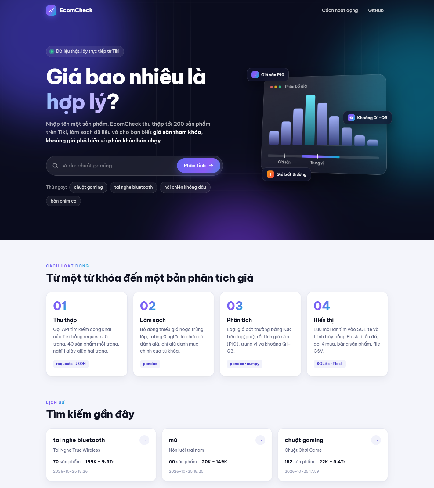
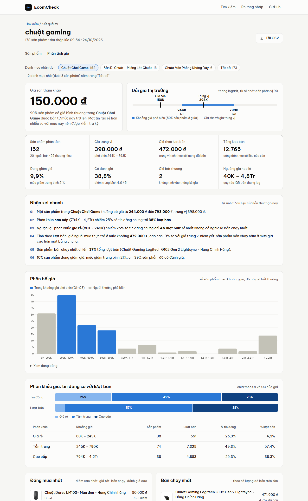
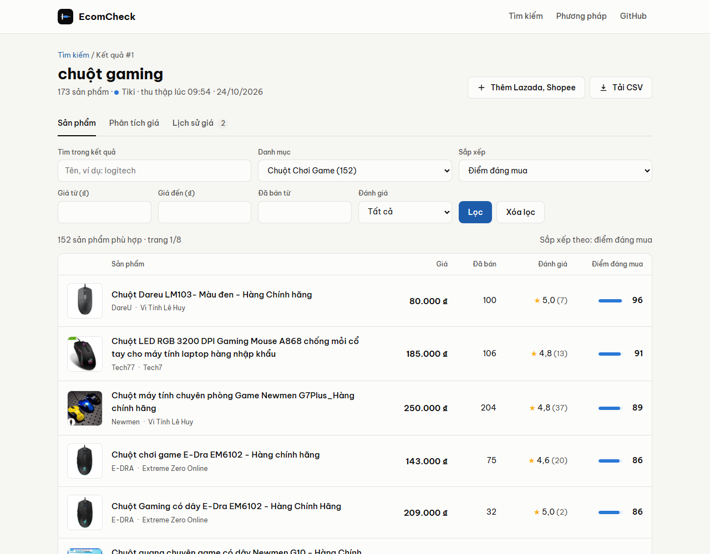
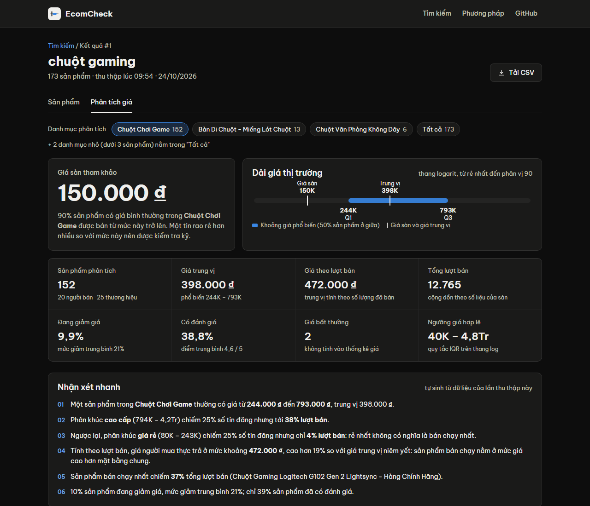
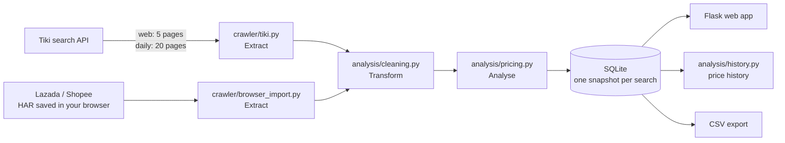
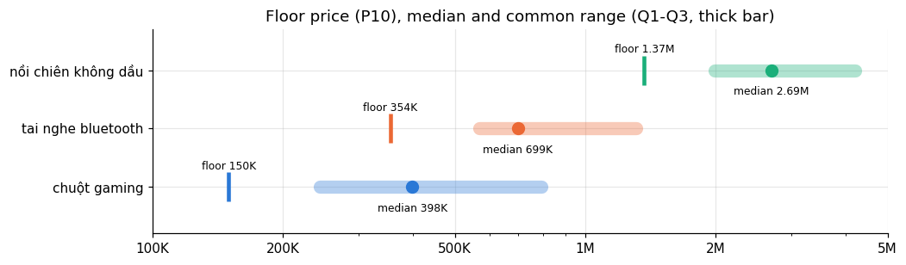
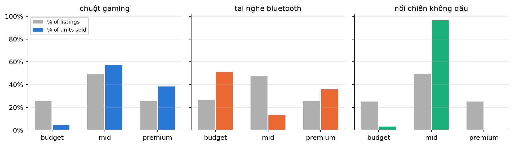
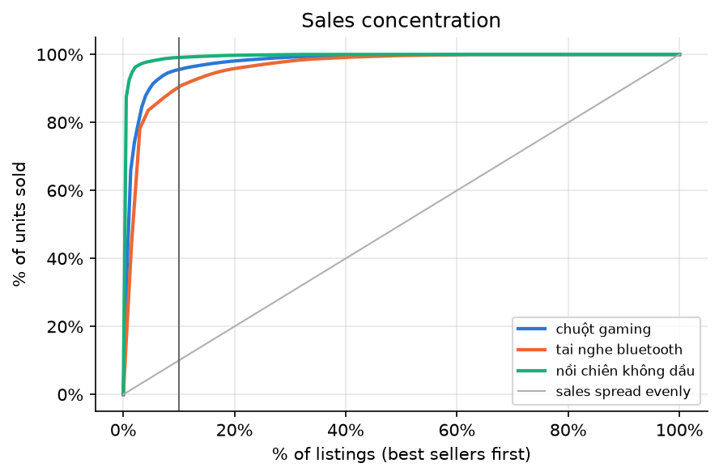

# EcomCheck — what is a fair price on a Vietnamese marketplace?

EcomCheck is an end-to-end data project. For any product keyword it **collects** the listings from Tiki's public search API (and Lazada/Shopee results you save from your own browser), **cleans** them, **analyses** the prices — a reference *floor price*, the common price range, unusual prices, which price segment actually sells, a transparent *deal score*, a comparison between marketplaces and the price history built by a daily collection — and **presents** the results in a Flask web app, a CSV export and two Jupyter notebooks.



| Price dashboard | Products | Dark mode |
|---|---|---|
|  |  |  |

## What this project demonstrates

| Skill | Where to look |
|---|---|
| **Data collection** from a JSON API: pagination, timeouts, pauses between requests, back-off when rate limited, robots.txt check | [`crawler/tiki.py`](crawler/tiki.py), [`notebooks/01_data_collection.ipynb`](notebooks/01_data_collection.ipynb) |
| **Reading network traffic**: extracting Lazada/Shopee search results from a browser HAR export, without bypassing their anti-bot protection | [`crawler/browser_import.py`](crawler/browser_import.py) |
| **Automation**: daily batch collection with logging, scheduled with the Windows Task Scheduler | [`collect.py`](collect.py), [`schedule_daily.ps1`](schedule_daily.ps1) |
| **Data cleaning & validation**: text normalisation for Vietnamese, parsing "1.2K sold", relevance filtering, data-quality checks | [`analysis/cleaning.py`](analysis/cleaning.py), [`tests/`](tests) |
| **SQL & data modelling**: schema with proper numeric types, parameterised queries, filtering/sorting/pagination in SQL, snapshots over time | [`database/schema.sql`](database/schema.sql), [`database/db.py`](database/db.py) |
| **Statistics**: percentiles, IQR outliers on a log scale, weighted median, Bayesian average, Spearman correlation, like-for-like price change | [`analysis/pricing.py`](analysis/pricing.py), [`analysis/history.py`](analysis/history.py), [`notebooks/02_price_analysis.ipynb`](notebooks/02_price_analysis.ipynb) |
| **Communicating results**: dashboard, marketplace comparison, price history, auto-generated insights, method page, CSV export | [`app.py`](app.py), [`web/`](web) |

## How it works



1. **Collect**
   - **Tiki:** `tiki.vn/api/v2/products`, the endpoint the website itself calls. No login, allowed by robots.txt, a pause between pages, back-off when rate limited, results re-used for 30 minutes. A web search takes 5 pages (200 products); `collect.py` takes 20 pages per keyword for every keyword in `keywords.txt`, and can run every day.
   - **Lazada and Shopee** block automated requests (anti-bot page, HTTP 403), so the app never calls them. You search on their websites as usual, export the network log (HAR) from DevTools and upload it; the app reads only the search responses inside it.
2. **Clean** — drop rows without a price or link, remove duplicates, fix discounts, treat a 0-star rating as *not rated*, and keep only products relevant to the keyword (name match **or** the main category of the exact matches). Lazada and Shopee send no category name, so their products (whose names contain the keyword) are put in the main category of the search.
3. **Analyse** — inside each category (so mouse pads never pull down the price of gaming mice):
   - **Unusual prices**: Tukey's IQR rule on `log10(price)`, because prices are right-skewed.
   - **Floor price** (*giá sàn tham khảo*): the 10th percentile of normal prices — 90 % of listings cost more.
   - **Common range**: Q1–Q3. **Sales-weighted median**: the median price of the units sold, shown with the best seller's share of units because one product often decides it.
   - **Deal score (0–100)**: `0.3 × cheap rank + 0.4 × sold rank + 0.3 × rating rank`, with ratings adjusted by a Bayesian average so that 5★ from one review does not beat 4.8★ from a thousand.
   - **Marketplace comparison**: floor price, common range and sales-weighted median per marketplace, on one price line.
   - **Price history** (from the daily snapshots): the *like-for-like* price change of products present in every snapshot — the market median can move just because the product mix changed — and units actually sold between two snapshots (`sold` is cumulative).
4. **Present** — product list with filters and sorting done in SQL, a dashboard per category, auto-generated insights, CSV download, and a page that explains every formula.

## Key findings

From the sample analysed in [`02_price_analysis.ipynb`](notebooks/02_price_analysis.ipynb): 567 products for three keywords, collected from Tiki on 24 October 2026, each analysed in its main category.

| Keyword | Floor price (P10) | Common range (Q1–Q3) | Median listing | Sales-weighted median* | Best seller's share of units | Without the best seller* |
|---|---|---|---|---|---|---|
| chuột gaming | 150K | 244K – 793K | 398K | 472K | 37 % | 805K |
| tai nghe bluetooth (true wireless) | 355K | 560K – 1.3M | 699K | 525K | 45 % | 3.09M |
| nồi chiên không dầu | 1.33M | 1.99M – 4.2M | 2.69M | 2.17M | 87 % | 2.39M |

<sub>* sales-weighted median: line up every unit sold by price and take the middle one. "Without the best seller": the same, after removing the top-selling product.</sub>



1. **"What buyers pay" is the price of the best seller.** One product sells 37 % (mice), 45 % (earbuds) and 87 % (air fryers) of all units, so the sales-weighted median is that product's price or sits right next to it. Remove that one product and the number jumps to the next best seller's price (805K, 3.09M, 2.39M). The gap to the median listing (+19 % for mice, −25 % and −19 % for the others) shows how concentrated these markets are, not a general rule about what buyers pay.
2. **Winner-take-most markets.** The top 10 % of listings take 91–99 % of all units sold, and 37–68 % of listings have never sold.
3. **The cheapest is not what sells** — for gaming mice the cheapest quarter of listings gets only 4 % of units sold. For earbuds it gets 51 %, but mostly through one 359K product.
4. **Star ratings say little.** The median rated product has 5.0★ and 69 % of products have no rating. The number of reviews follows sales much more closely: Spearman ρ 0.71–0.88 on all products, and still 0.72–0.83 on products that sold at least once, so it is not just the many products with 0 sold and 0 reviews. A review needs a purchase, so this is a consistency check on the data rather than a cause of sales.
5. **The deal score behaves as designed, but it is not validated.** Its top-10 products are cheaper than the median listing and have sold more (median 9–54 units vs 0–1 overall), partly by construction: units sold are 40 % of the score. An out-of-time test (score on day *t*, units sold between *t* and *t + 7*) is described in the notebook and needs a week of daily snapshots.

| Price segments: listings vs units sold | Sales concentration |
|---|---|
|  |  |

## Run it locally

Requires Python 3.10+. No database server needed: SQLite is created automatically.

```bash
git clone https://github.com/NamAnh-dev/Web-Crawler-for-E-commerce-Prices.git
cd Web-Crawler-for-E-commerce-Prices
python -m venv venv
venv\Scripts\activate          # macOS / Linux: source venv/bin/activate
pip install -r requirements.txt
```

| Task | Command |
|---|---|
| Start the web app, then open http://127.0.0.1:5000 | `python app.py` |
| Collect one keyword from the terminal | `python run_crawl.py "chuột gaming" --pages 10` |
| Collect every keyword of `keywords.txt` (20 pages each, ~2 min per keyword) | `python collect.py` |
| Run `collect.py` every day at 08:00 (Windows) | `.\schedule_daily.ps1 -At 08:00` |
| Stop the daily collection | `.\schedule_daily.ps1 -Remove` |
| Run the tests (no internet needed) | `pytest` |
| Open the notebooks | `jupyter notebook notebooks/` |

**Adding Lazada and Shopee:** open a search result in the web app and click **Thêm Lazada, Shopee**. The page explains the steps: open DevTools (F12) → Network → tick *Preserve log*, search on lazada.vn or shopee.vn (logged in, as usual) and go through a few result pages, then *Export HAR (sanitized)* and upload the file. HAR files stay on your computer: they are ignored by git.

Settings (pages per search, pause between requests, database path…) can be changed in a `.env` file — see [`.env.example`](.env.example).

## Project structure

```
├── app.py                  Flask routes and number formats
├── run_crawl.py            ETL pipeline: crawl → clean → analyse → save, and HAR import (CLI + web)
├── collect.py              daily batch collection of the keywords in keywords.txt
├── schedule_daily.ps1      registers collect.py in the Windows Task Scheduler
├── config.py               settings, read from .env
├── crawler/
│   ├── tiki.py             Extract: Tiki public search API
│   ├── browser_import.py   Extract: search responses inside a HAR / JSON / HTML file
│   ├── lazada.py           parse Lazada search results
│   └── shopee.py           parse Shopee search results
├── analysis/
│   ├── cleaning.py         Transform: normalise, parse, filter relevant products
│   ├── pricing.py          Analyse: unusual prices, reference prices, deal score, marketplaces
│   └── history.py          Analyse: changes between snapshots
├── database/
│   ├── schema.sql          tables: search_runs, products
│   └── db.py               all SQL queries
├── web/
│   ├── templates/          Jinja pages: home, products, dashboard, import, history, method
│   └── static/             CSS (light + dark), Chart.js scripts
├── notebooks/
│   ├── 01_data_collection.ipynb
│   └── 02_price_analysis.ipynb
├── data/sample/            sample dataset used by notebook 02
├── docs/                   screenshots and figures
└── tests/                  pytest: cleaning, pricing, web pages
```

## Data model

| Table | Columns |
|---|---|
| `search_runs` | `id`, `keyword`, `product_count`, `notes`, `created_at` — one row per search, a snapshot of the market at that time |
| `products` | `run_id`, `source`, `product_id`, `name`, `brand`, `seller`, `category`, `price`, `original_price`, `discount_pct`, `sold`, `rating`, `review_count`, `image_url`, `product_url`, `price_flag`, `deal_score` |

## Version 2: what I fixed after reviewing version 1

Version 1 was built during my Data Collection / Data Analyst internship (2025) with MySQL. Re-running it a year later showed that it no longer collected any data, and a code review found several logic problems:

| Version 1 | Version 2 |
|---|---|
| The Tiki product link was read from the *advertisement* field; the API no longer returns it, so **every Tiki row was dropped** and searches returned 0 products. | Link built from `url_path`. |
| `"1.2K sold"` was parsed as **1** (the `e` of `1.2e3` was stripped by the regex). | `parse_sold()` with unit tests. |
| The keyword filter dropped real matches ("Chuột **chơi game**" for "chuột gaming") but kept mouse pads. | Name match **or** main category; every statistic computed per category. |
| Prices, ratings and sold counts stored as `VARCHAR`; missing ratings stored as `''` and averaged as 0 stars; ratings averaged after `CAST(... AS UNSIGNED)`, which drops the decimals of 4.8★. | Proper `INTEGER`/`REAL` columns, `NULL` for not rated. |
| Every search **deleted the whole table**, so only one search could exist. | `search_runs` table: every search is kept as a snapshot. |
| "Best deal" compared the *average* of each platform, which says little about any product. | Per-product deal score with percentile ranks and a Bayesian-adjusted rating. |
| The crawler ran through a hard-coded Windows path (`D:\Programming\...`) and its errors were hidden. | Pipeline called directly; skipped sources are recorded and shown. |
| Database password in two source files; cookies and a password file committed to the repository; Flask debug mode open on `0.0.0.0`. | Settings in `.env` (ignored by git); debug off by default and bound to localhost. |
| Product names inserted into JavaScript with `JSON.parse('...')`, which breaks on an apostrophe. | Data passed as `<script type="application/json">`. |
| No timeout, no pause between requests. | Timeout, 1 s pause, back-off when rate limited, 30-minute cache. |

## Limitations

- One search is one moment: prices change with flash sales and vouchers are not included.
- `sold` is the cumulative number shown by Tiki, not sales over a fixed period.
- Only the first 200 results in Tiki's ranking are collected, which favours promoted and popular products.
- The deal-score weights are a reasoned choice, not learned from purchase data.
- Lazada and Shopee data only covers the pages you saved, so the marketplaces have different sample sizes; a few accessories whose names contain the keyword (e.g. a *gaming* mouse pad) can slip into the main category.

**Next steps:** after a few weeks of daily snapshots, a third notebook on price history (seasonality, real vs inflated discounts, sales velocity), and running the collection in the cloud (e.g. GitHub Actions) instead of a personal computer.

## Responsible data collection

Only public product information is collected, through the endpoint the website itself uses, at a low request rate and for personal learning. No login and no attempt to get around anti-bot protections: Lazada and Shopee data comes only from pages you viewed yourself in your browser, and those files are never committed.

## Credits

Built by Nam Anh. Version 2 was rebuilt with the help of [Claude Code](https://claude.com/claude-code) (Anthropic); in particular, the web interface (HTML, CSS and JavaScript) was designed and built by Claude.
