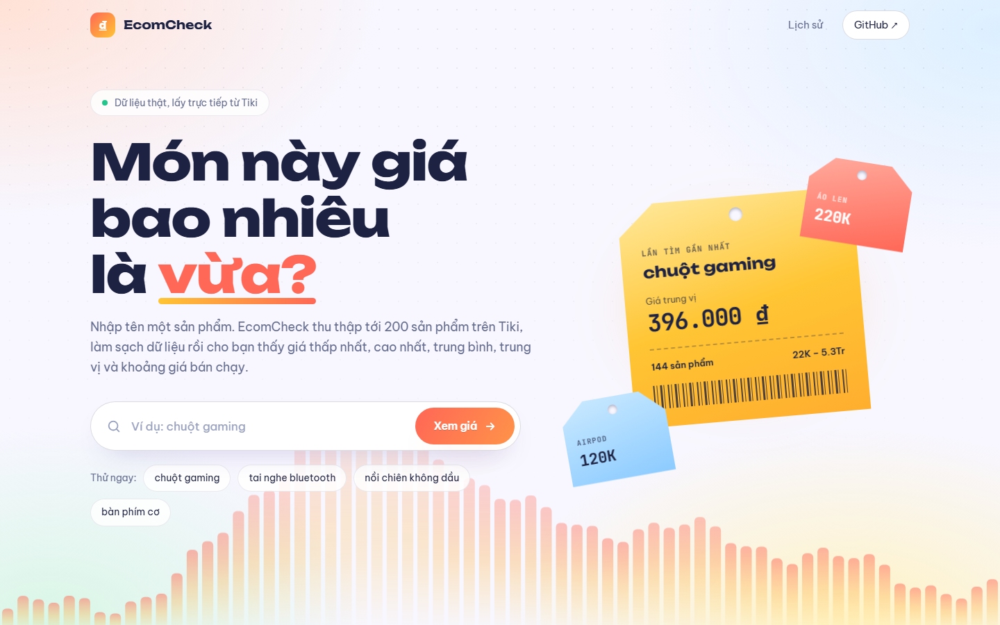
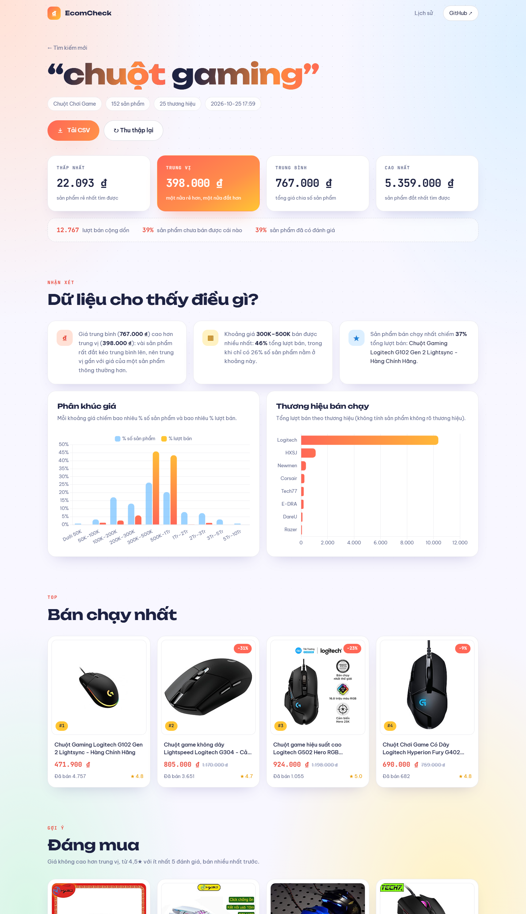
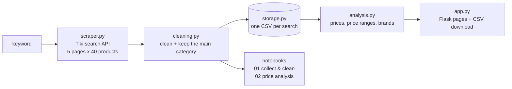
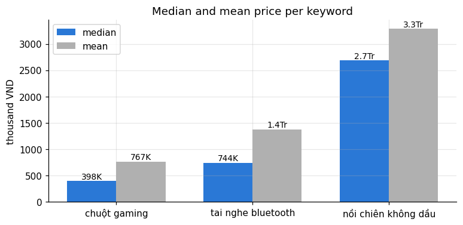
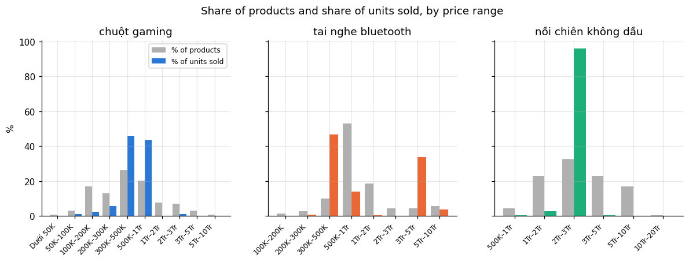
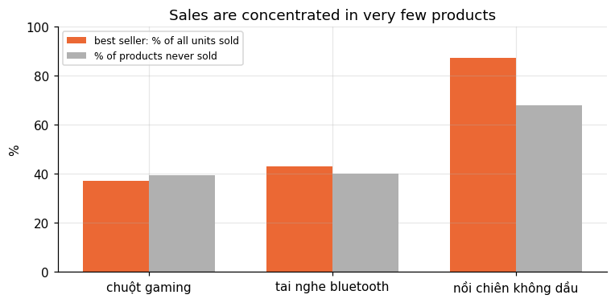

# EcomCheck — what do products cost on Tiki?

*Self-taught project that I started during my Data Collection internship at POS365 (2025), where I mostly worked with APIs. Rebuilt and simplified in 2026 after reviewing my own code (see [History](#history)).*

Type a product name. EcomCheck collects up to 200 products from **Tiki**, cleans the data, and shows:

- the **lowest, highest, mean and median price**,
- the **price ranges**: how many products and how many units sold in each,
- the **best sellers**, the **brands** that sell, and a few **good deals**.





## What I practised

| Skill | Where to look |
|---|---|
| **Collecting data with `requests`**: Tiki's JSON search API (found with Chrome DevTools), pagination, a pause between requests, waiting and retrying when Tiki answers *429 Too Many Requests* | [`scraper.py`](scraper.py) |
| **HTML parsing with BeautifulSoup**: why `requests` finds 0 product cards on the search page, reading the data the page embeds in `<script id="__NEXT_DATA__">`, and comparing it with the API | [`scraper.py`](scraper.py), [`notebooks/01_collect_and_clean.ipynb`](notebooks/01_collect_and_clean.ipynb) |
| **Data cleaning with pandas**: missing values, duplicates, rating 0 = *not rated yet*, accent-insensitive keyword matching, one category per search | [`cleaning.py`](cleaning.py), notebook 01 |
| **Simple analysis with pandas**: min / max / mean / median, counting and summing by price range, `groupby` by brand, charts with matplotlib | [`analysis.py`](analysis.py), [`notebooks/02_price_analysis.ipynb`](notebooks/02_price_analysis.ipynb) |
| **Saving to CSV**: one file per search, readable in Excel (`utf-8-sig`) | [`storage.py`](storage.py) |
| **Flask** (self-taught): routes, Jinja templates, flash messages, CSV download | [`app.py`](app.py), [`templates/`](templates) |

## How it works



1. **Collect** — `scraper.crawl()` calls `tiki.vn/api/v2/products`, the endpoint the Tiki search page itself calls (found in Chrome DevTools > Network). No login, allowed by robots.txt, 1 second between two pages. If Tiki answers HTTP 429/503 (or an HTML page instead of JSON), it waits and tries again.
   I also read the search page with BeautifulSoup (`scraper.parse_search_page()`): the product cards are drawn by JavaScript, so they are not in the HTML that `requests` downloads, but the page writes the same data as JSON in a `__NEXT_DATA__` script tag. Notebook 01 shows both ways give the same 40 products per page; the API is about 4 times smaller and has no ads to remove, so the app uses the API.
2. **Clean** — drop rows without a name, link or price and duplicated products; no original price means no discount; a rating of 0 means *not rated yet* (empty, not 0 stars); "OEM / No brand" means no brand; keep only the **main category** of the search, so that mouse pads are never compared with gaming mice.
3. **Save** — every search is saved as one CSV file in `data/searches/` (`3.csv` is the search shown at `/result/3`).
4. **Analyse** — lowest, highest, mean and median price; products and units sold in each round price range (under 50K, 50K–100K, 100K–200K…); units sold per brand; a simple "good deal" filter (price at most the median, 4.5★ or more from at least 5 reviews, most sold first).
5. **Show** — a Flask page with the numbers, two charts, best sellers, a product table you can filter and sort, and a CSV download.

## Key findings

From [`02_price_analysis.ipynb`](notebooks/02_price_analysis.ipynb): 410 products for three keywords, collected from Tiki on 25 October 2026, one category per keyword.

| Keyword (category) | Lowest | Median | Mean | Highest | Best seller's share of units | Never sold |
|---|---|---|---|---|---|---|
| chuột gaming (Chuột Chơi Game) | 22K | 398K | 767K | 5.36M | 37.3 % | 39.5 % |
| tai nghe bluetooth (Tai Nghe True Wireless) | 199K | 744K | 1.38M | 9.56M | 42.9 % | 40.0 % |
| nồi chiên không dầu (Nồi chiên) | 599K | 2.69M | 3.29M | 10.82M | 87.3 % | 68.1 % |



1. **The median is the "usual price".** The mean is 1.22 to 1.93 times higher than the median, because a few very expensive products pull it up: half of the gaming mice cost less than 398K, but the mean is 767K.
2. **The cheapest products are not the ones that sell.** For gaming mice, products under 300K are 34.3 % of the products but only 9.6 % of the units sold; the ranges 300K–1M hold 89.2 % of the units sold.
3. **Sales are concentrated in very few products.** One product sells 37–87 % of all units, and 40–68 % of the products have never sold. Numbers weighted by sales mostly describe those few best sellers.
4. **One brand leads each category**: Logitech 81.2 % of the gaming mice sold, LocknLock 92.6 % of the air fryers, Hoco 42.9 % of the earbuds.

| Price ranges: products vs units sold | Sales concentration |
|---|---|
|  |  |

## Run it locally

Requires Python 3.10+. No database: searches are saved as CSV files in `data/searches/`.

```bash
git clone https://github.com/NamAnh-dev/Web-Crawler-for-E-commerce-Prices.git
cd Web-Crawler-for-E-commerce-Prices
python -m venv venv
venv\Scripts\activate          # macOS / Linux: source venv/bin/activate
pip install -r requirements.txt
```

| Task | Command |
|---|---|
| Start the web app, then open http://127.0.0.1:5000 | `python app.py` |
| Collect one keyword from the terminal and save a CSV in `data/` | `python scraper.py "chuột gaming" --pages 5` |
| Run the tests (no internet needed) | `pytest` |
| Open the notebooks | `jupyter notebook notebooks/` |

## Project structure

```
├── scraper.py          1. collect: Tiki search API (requests) and search page (BeautifulSoup)
├── cleaning.py         2. clean: missing values, duplicates, ratings, main category
├── storage.py          3. save: one CSV file per search
├── analysis.py         4. analyse: price summary, price ranges, brands, good deals
├── app.py              5. show: Flask routes
├── templates/          Jinja pages: home, result, 404
├── static/             CSS, JavaScript (animations, charts), icon
├── notebooks/
│   ├── 01_collect_and_clean.ipynb   robots.txt, HTML vs API, cleaning step by step, builds the sample
│   └── 02_price_analysis.ipynb      analysis of the sample
├── data/tiki_sample.csv             sample used by notebook 02
├── docs/                            screenshots and figures
└── tests/                           15 small pytest tests, one file per module
```

## Data

Every saved search and the sample file have the same columns:

| Column | Meaning |
|---|---|
| `keyword`, `crawled_at` | what was searched, and when |
| `product_id`, `name`, `brand`, `category` | the product (`brand` is empty for "OEM / No brand") |
| `price`, `original_price`, `discount_pct` | VND; `original_price` equals `price` when there is no discount |
| `sold` | units sold since the product was listed (cumulative) |
| `rating`, `review_count` | `rating` is empty when nobody has rated the product yet |
| `image_url`, `product_url` | links to the picture and to the product page |

## History

**Version 1 (2025, internship):** Flask + MySQL, collecting Tiki and Lazada through their JSON APIs.

**2026 review.** A year later version 1 no longer collected any data, and reading my own code showed several problems. The main ones:

| Version 1 | Now |
|---|---|
| The Tiki product link was read from the *advertisement* field, which the API no longer sends, so **every row was dropped**. | Link built from `url_path`. |
| The keyword filter dropped real matches ("Chuột **chơi game**" for "chuột gaming") but kept mouse pads. | Whole-word, accent-insensitive matching finds the main category, and only that category is kept. |
| Prices and ratings stored as text; a missing rating was averaged as 0 stars. | Numbers stay numbers; an empty rating stays empty. |
| Every search **deleted the whole table**. | Every search is kept as its own CSV file. |
| No timeout and no pause between requests. | Timeout, 1 s pause between pages, wait and retry when Tiki answers 429/503. |
| A database password and cookies were in the code; Flask debug mode was open on `0.0.0.0`. | No secrets in the code; the app runs on localhost with debug off. |

**2026 simplifications.** Two rebuilds (visible in the git history) had grown bigger than what I can explain line by line, so I cut them down twice:

- first I removed the Lazada/Shopee import from browser HAR files, a daily scheduled collection, price history, a weighted "deal score" and a Selenium scraper, to keep one pipeline on Tiki;
- then I removed the SQLite database (searches are now CSV files), the "floor price" (10th percentile), the detection of unusual prices (IQR rule on log prices) and most of the tests. Statistics is not my strong point yet, so the analysis now only uses numbers I can fully explain: min, max, mean, median, counts and sums.

## Limitations

- One search is one moment: prices change with flash sales, and vouchers are not included.
- `sold` is the cumulative number shown by Tiki, not sales over a fixed period.
- Only the first 200 results of Tiki's ranking are collected, which favours promoted and popular products.
- Keeping one category per keyword also removes some real matches that sellers listed in another category (e.g. a gaming mouse listed under *office mice*).
- Very cheap or very expensive listings are not removed, so the lowest and highest price can be an accessory or a flagship product; the median is not affected much.
- Sales are concentrated in 1–3 products per keyword, so sales-weighted numbers mostly describe those products.
- The "good deal" rule is a simple filter, not a validated recommendation.
- When it receives many requests in a short time, Tiki answers with a security-check page instead of JSON. The scraper then waits and tries again, and stops with a message if Tiki still refuses.

## Responsible data collection

Only public product information is collected, through the endpoint the website itself uses, a few pages at a time with a pause between requests, for personal learning. No login and no attempt to get around rate limits: when Tiki asks to slow down, the scraper waits.

## Credits

Built by Nam Anh. Rebuilt in 2026 with the help of [Claude Code](https://claude.com/claude-code) (Anthropic). **The web interface (HTML, CSS, JavaScript, animations and visual effects) was designed and built by Claude**; it is there to present the data nicely and is not part of the skills I claim. My own focus is the Python side: collecting, cleaning and analysing the data.
