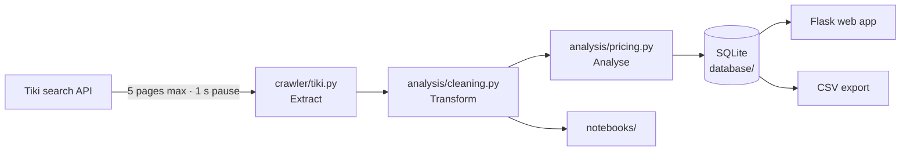

# EcomCheck — what is a fair price on a Vietnamese marketplace?

EcomCheck is an end-to-end data project. For any product keyword it **collects** the listings from Tiki's public search API, **cleans** them, **analyses** the prices — a reference *floor price*, the common price range, unusual prices, which price segment actually sells, and a transparent *deal score* — and **presents** the results in a Flask web app, a CSV export and two Jupyter notebooks.


| Products | Home | Dark mode |
|---|---|---|
|  |  |  |

## What this project demonstrates

| Skill | Where to look |
|---|---|
| **Data collection** from a JSON API: pagination, timeouts, pauses between requests, back-off when rate limited, robots.txt check | [`crawler/tiki.py`](crawler/tiki.py), [`notebooks/01_data_collection.ipynb`](notebooks/01_data_collection.ipynb) |
| **Data cleaning & validation**: text normalisation for Vietnamese, parsing "1.2K sold", relevance filtering, data-quality checks | [`analysis/cleaning.py`](analysis/cleaning.py), [`tests/`](tests) |
| **SQL & data modelling**: schema with proper numeric types, parameterised queries, filtering/sorting/pagination in SQL | [`database/schema.sql`](database/schema.sql), [`database/db.py`](database/db.py) |
| **Statistics**: percentiles, IQR outliers on a log scale, weighted median, Bayesian average, Spearman correlation | [`analysis/pricing.py`](analysis/pricing.py), [`notebooks/02_price_analysis.ipynb`](notebooks/02_price_analysis.ipynb) |
| **Communicating results**: dashboard, auto-generated insights, method page, CSV export | [`app.py`](app.py), [`web/`](web) |

## How it works



1. **Collect** — up to 200 products per keyword from `tiki.vn/api/v2/products`, the endpoint the website itself calls. No login, allowed by robots.txt, one-second pause between pages, results re-used for 30 minutes.
2. **Clean** — drop rows without a price or link, remove duplicates, fix discounts, treat a 0-star rating as *not rated*, and keep only products relevant to the keyword (name match **or** the main category of the exact matches).
3. **Analyse** — inside each category (so mouse pads never pull down the price of gaming mice):
   - **Unusual prices**: Tukey's IQR rule on `log10(price)`, because prices are right-skewed.
   - **Floor price** (*giá sàn tham khảo*): the 10th percentile of normal prices — 90 % of listings cost more.
   - **Common range**: Q1–Q3. **Sales-weighted median**: what buyers actually pay.
   - **Deal score (0–100)**: `0.3 × cheap rank + 0.4 × sold rank + 0.3 × rating rank`, with ratings adjusted by a Bayesian average so that 5★ from one review does not beat 4.8★ from a thousand.
4. **Present** — product list with filters and sorting done in SQL, a dashboard per category, auto-generated insights, CSV download, and a page that explains every formula.

## Key findings

From the sample analysed in [`02_price_analysis.ipynb`](notebooks/02_price_analysis.ipynb): 567 products for three keywords, collected from Tiki on 24 October 2026, each analysed in its main category.

| Keyword | Floor price (P10) | Common range (Q1–Q3) | Median listing | What buyers pay* |
|---|---|---|---|---|
| chuột gaming | 150K | 244K – 793K | 398K | **472K** |
| tai nghe bluetooth (true wireless) | 355K | 560K – 1.3M | 699K | **525K** |
| nồi chiên không dầu | 1.33M | 1.99M – 4.2M | 2.69M | **2.17M** |

<sub>* sales-weighted median: the median price of the units actually sold.</sub>


1. **Listing prices are not paid prices.** Buyers of gaming mice pay 19 % *more* than the median listing; buyers of earbuds and air fryers pay 19–25 % *less*.
2. **Winner-take-most markets.** The top 10 % of listings take 91–99 % of all units sold, and 37–68 % of listings have never sold. One air fryer accounts for 87 % of units sold.
3. **The cheapest is not what sells** — for gaming mice the cheapest quarter of listings gets only 4 % of sales, while for earbuds it gets 51 %.
4. **Star ratings say little.** The median rated product has 5.0★ and 69 % of products have no rating; the number of reviews is a far better proxy for popularity (Spearman ρ 0.71–0.88 with units sold).
5. **The deal score works as intended**: its top-10 products cost about half the median price and still sell (median 15–54 units vs 0–1 overall).

| Price segments: listings vs units sold | Sales concentration |
|---|---|
|  |  |

## Run it locally

Requires Python 3.10+. No database server needed: SQLite is created automatically.

```bash
git clone https://github.com/NamAnh-dev/Web-Crawler-for-E-commerce-Prices.git
cd Web-Crawler-for-E-commerce-Prices
python -m venv venv
venv\Scripts\activate          # macOS / Linux: source venv/bin/activate
pip install -r requirements.txt
```

| Task | Command |
|---|---|
| Start the web app, then open http://127.0.0.1:5000 | `python app.py` |
| Run the pipeline from the terminal | `python run_crawl.py "chuột gaming"` |
| Run the tests (no internet needed) | `pytest` |
| Open the notebooks | `jupyter notebook notebooks/` |

Settings (pages per search, pause between requests, database path…) can be changed in a `.env` file — see [`.env.example`](.env.example).

## Project structure

```
├── app.py                  Flask routes and number formats
├── run_crawl.py            ETL pipeline: crawl → clean → analyse → save (CLI + web)
├── config.py               settings, read from .env
├── crawler/
│   ├── tiki.py             Extract: Tiki public search API
│   └── lazada.py           Extract: optional source (needs your own browser cookie)
├── analysis/
│   ├── cleaning.py         Transform: normalise, parse, filter relevant products
│   └── pricing.py          Analyse: unusual prices, reference prices, deal score
├── database/
│   ├── schema.sql          tables: search_runs, products
│   └── db.py               all SQL queries
├── web/
│   ├── templates/          Jinja pages: home, products, dashboard, method
│   └── static/             CSS (light + dark), Chart.js script
├── notebooks/
│   ├── 01_data_collection.ipynb
│   └── 02_price_analysis.ipynb
├── data/sample/            sample dataset used by notebook 02
├── docs/                   screenshots and figures
└── tests/                  pytest: cleaning, pricing, web pages
```

## Data model

| Table | Columns |
|---|---|
| `search_runs` | `id`, `keyword`, `product_count`, `notes`, `created_at` — one row per search, a snapshot of the market at that time |
| `products` | `run_id`, `source`, `product_id`, `name`, `brand`, `seller`, `category`, `price`, `original_price`, `discount_pct`, `sold`, `rating`, `review_count`, `image_url`, `product_url`, `price_flag`, `deal_score` |

## Version 2: what I fixed after reviewing version 1

Version 1 was built during my Data Collection / Data Analyst internship (2025) with MySQL. Re-running it a year later showed that it no longer collected any data, and a code review found several logic problems:

| Version 1 | Version 2 |
|---|---|
| The Tiki product link was read from the *advertisement* field; the API no longer returns it, so **every Tiki row was dropped** and searches returned 0 products. | Link built from `url_path`. |
| `"1.2K sold"` was parsed as **1** (the `e` of `1.2e3` was stripped by the regex). | `parse_sold()` with unit tests. |
| The keyword filter dropped real matches ("Chuột **chơi game**" for "chuột gaming") but kept mouse pads. | Name match **or** main category; every statistic computed per category. |
| Prices, ratings and sold counts stored as `VARCHAR`; missing ratings stored as `''` and averaged as 0 stars; ratings averaged after `CAST(... AS UNSIGNED)`, which drops the decimals of 4.8★. | Proper `INTEGER`/`REAL` columns, `NULL` for not rated. |
| Every search **deleted the whole table**, so only one search could exist. | `search_runs` table: every search is kept as a snapshot. |
| "Best deal" compared the *average* of each platform, which says little about any product. | Per-product deal score with percentile ranks and a Bayesian-adjusted rating. |
| The crawler ran through a hard-coded Windows path (`D:\Programming\...`) and its errors were hidden. | Pipeline called directly; skipped sources are recorded and shown. |
| Database password in two source files; cookies and a password file committed to the repository; Flask debug mode open on `0.0.0.0`. | Settings in `.env` (ignored by git); debug off by default and bound to localhost. |
| Product names inserted into JavaScript with `JSON.parse('...')`, which breaks on an apostrophe. | Data passed as `<script type="application/json">`. |
| No timeout, no pause between requests. | Timeout, 1 s pause, back-off when rate limited, 30-minute cache. |

## Limitations

- One search is one moment: prices change with flash sales and vouchers are not included.
- `sold` is the cumulative number shown by Tiki, not sales over a fixed period.
- Only the first 200 results in Tiki's ranking are collected, which favours promoted and popular products.
- The deal-score weights are a reasoned choice, not learned from purchase data.
- Lazada is supported only with your own browser cookie, because it answers automated requests with an anti-bot page; Shopee is not included for the same reason.

**Next steps:** schedule daily searches to analyse price changes over time (the `search_runs` table already supports it), and compare the floor price with prices on other marketplaces.

## Responsible data collection

Only public product information is collected, through the endpoint the website itself uses, at a low request rate and for personal learning. No personal data, no login and no attempt to get around anti-bot protections.

## Credits

Built by Nam Anh. Version 2 was rebuilt with the help of [Claude Code](https://claude.com/claude-code) (Anthropic); in particular, the web interface (HTML, CSS and JavaScript) was designed and built by Claude.
