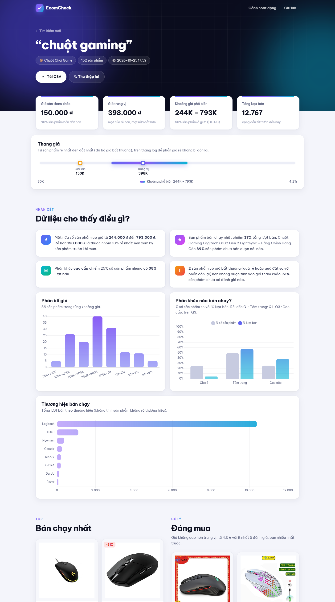
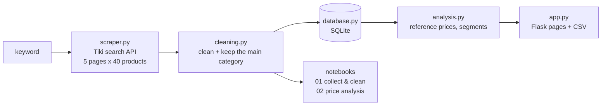

# EcomCheck — what is a fair price on Tiki?

*Self-directed project from my Data Collection internship at POS365 (2025), done under my mentor's guidance to practise web scraping, Flask and data analysis. Rebuilt and simplified in 2026 after reviewing my own code (see [History](#history)).*

Type a product name. EcomCheck collects up to 200 products from **Tiki**, cleans the data, and tells you:

- the **floor price** (*giá sàn tham khảo*): 90 % of listings cost more,
- the **common price range**: the middle 50 % of listings,
- which prices are **unusual**, which **price segment sells**, the **best sellers** and the **brands** that sell.




## What I practised

| Skill | Where to look |
|---|---|
| **Web scraping with `requests`**: Tiki's JSON search API, pagination, a pause between requests, waiting and retrying when Tiki answers *429 Too Many Requests* | [`scraper.py`](scraper.py) |
| **HTML parsing with BeautifulSoup**: why `requests` finds 0 product cards on the search page, reading the data the page embeds in `<script id="__NEXT_DATA__">`, and comparing it with the API | [`scraper.py`](scraper.py), [`notebooks/01_collect_and_clean.ipynb`](notebooks/01_collect_and_clean.ipynb) |
| **Data cleaning with pandas**: missing values, duplicates, rating 0 = *not rated yet*, accent-insensitive keyword matching, one category per search | [`cleaning.py`](cleaning.py), notebook 01 |
| **Analysis**: percentiles, IQR on `log10(price)`, price segments with `groupby`, sales concentration, Spearman correlation | [`analysis.py`](analysis.py), [`notebooks/02_price_analysis.ipynb`](notebooks/02_price_analysis.ipynb) |
| **SQL**: two tables, parameterised queries, `JOIN` + `GROUP BY` | [`database.py`](database.py) |
| **Flask**: routes, Jinja templates, flash messages, CSV download, tests with the Flask test client | [`app.py`](app.py), [`templates/`](templates), [`tests/`](tests) |

## How it works



1. **Collect** — `scraper.crawl()` calls `tiki.vn/api/v2/products`, the endpoint the Tiki search page itself calls (found in Chrome DevTools > Network). No login, allowed by robots.txt, 1 second between two pages. If Tiki answers HTTP 429/503 (or an HTML page instead of JSON), it waits and tries again.
   I also read the search page with BeautifulSoup (`scraper.get_html_page()`): the product cards are drawn by JavaScript, so they are not in the HTML that `requests` downloads, but the page writes the same data as JSON in a `__NEXT_DATA__` script tag. Notebook 01 shows both ways give the same 40 products per page; the API is about 4 times smaller and has no ads to remove, so the app uses the API.
2. **Clean** — drop rows without a name, link or price and duplicated products; no original price means no discount; a rating of 0 means *not rated yet* (empty, not 0 stars); "OEM / No brand" means no brand; keep only the **main category** of the search, so that mouse pads are never compared with gaming mice.
3. **Save** — every search is stored in SQLite: one row in `searches`, its products in `products`.
4. **Analyse** — unusual prices with Tukey's IQR rule on `log10(price)` (prices are right-skewed); floor = 10th percentile, common range = Q1–Q3, median; budget / mid / premium segments (cut at Q1 and Q3) compared by share of listings and share of units sold; a simple "good deal" rule (price at most the median, 4.5★ or more from at least 5 reviews, most sold first).
5. **Show** — a Flask page with the numbers, charts, best sellers, a product table you can filter and sort, and a CSV download.

## Key findings

From [`02_price_analysis.ipynb`](notebooks/02_price_analysis.ipynb): 410 products for three keywords, collected from Tiki on 25 October 2026, one category per keyword.

| Keyword (category) | Floor price (P10) | Common range (Q1–Q3) | Median | Best seller's share of units | Never sold |
|---|---|---|---|---|---|
| chuột gaming (Chuột Chơi Game) | 150K | 244K – 793K | 398K | 37 % | 39 % |
| tai nghe bluetooth (Tai Nghe True Wireless) | 354K | 568K – 1.31M | 699K | 45 % | 38 % |
| nồi chiên không dầu (Nồi chiên) | 1.37M | 1.99M – 4.2M | 2.69M | 88 % | 69 % |


1. **A floor price can be estimated from listings alone.** A gaming mouse under 150K or an air fryer under 1.37M is cheaper than 90 % of the listings: worth a closer look before buying.
2. **The cheapest is not what sells** for gaming mice: the cheapest quarter of listings gets only 4.3 % of units sold. For earbuds the budget quarter gets 51 %, but mostly through one 359K product.
3. **Sales are winner-take-most.** One product sells 37–88 % of all units, the top 10 % of listings sell 91–99 %, and 38–69 % of listings have never sold. Numbers weighted by sales mostly describe those few best sellers.
4. **Reviews follow sales, star ratings do not separate products.** Spearman ρ between reviews and units sold is 0.70–0.88, even on products that sold at least once; but only 15–47 % of products are rated and the median rating is 5.0.

| Price segments: listings vs units sold | Sales concentration |
|---|---|
|  |  |

## Run it locally

Requires Python 3.10+. No database server needed: SQLite creates `data/searches.db` by itself.

```bash
git clone https://github.com/NamAnh-dev/Web-Crawler-for-E-commerce-Prices.git
cd Web-Crawler-for-E-commerce-Prices
python -m venv venv
venv\Scripts\activate          # macOS / Linux: source venv/bin/activate
pip install -r requirements.txt
```

| Task | Command |
|---|---|
| Start the web app, then open http://127.0.0.1:5000 | `python app.py` |
| Collect one keyword from the terminal and save a CSV in `data/` | `python scraper.py "chuột gaming" --pages 5` |
| Run the tests (no internet needed) | `pytest` |
| Open the notebooks | `jupyter notebook notebooks/` |

## Project structure

```
├── scraper.py          1. collect: Tiki search API (requests) and search page (BeautifulSoup)
├── cleaning.py         2. clean: missing values, duplicates, ratings, main category
├── database.py         3. save: SQLite, tables `searches` and `products`
├── analysis.py         4. analyse: unusual prices, reference prices, segments, best sellers
├── app.py              5. show: Flask routes
├── templates/          Jinja pages: home, result, 404
├── static/             CSS, JavaScript (animations, charts), icon
├── notebooks/
│   ├── 01_collect_and_clean.ipynb   robots.txt, HTML vs API, cleaning step by step, builds the sample
│   └── 02_price_analysis.ipynb      analysis of the sample
├── data/tiki_sample.csv             sample used by notebook 02
├── docs/                            screenshots and figures
└── tests/                           pytest, one file per module
```

## Data model

| Table | Columns |
|---|---|
| `searches` | `id`, `keyword`, `category`, `created_at` |
| `products` | `search_id`, `product_id`, `name`, `brand`, `category`, `price`, `original_price`, `discount_pct`, `sold`, `rating`, `review_count`, `image_url`, `product_url` |

## History

**Version 1 (2025, internship):** Flask + MySQL, collecting Tiki and Lazada through their JSON APIs.

**2026 review.** A year later version 1 no longer collected any data, and reading my own code showed several problems. The main ones:

| Version 1 | Now |
|---|---|
| The Tiki product link was read from the *advertisement* field, which the API no longer sends, so **every row was dropped**. | Link built from `url_path`. |
| The keyword filter dropped real matches ("Chuột **chơi game**" for "chuột gaming") but kept mouse pads. | Whole-word, accent-insensitive matching finds the main category, and only that category is kept. |
| Prices and ratings stored as `VARCHAR`; a missing rating was averaged as 0 stars. | `INTEGER` / `REAL` columns, `NULL` = not rated. |
| Every search **deleted the whole table**. | Every search is kept (`searches` table). |
| No timeout and no pause between requests. | Timeout, 1 s pause between pages, wait and retry when Tiki answers 429/503. |
| A database password and cookies were in the code; Flask debug mode was open on `0.0.0.0`. | No secrets in the code; the app runs on localhost with debug off. |

**2026 simplification.** An intermediate rebuild (visible in the git history) had grown too big for a first project: Lazada/Shopee import from browser HAR files, a daily scheduled collection, price history, a weighted "deal score", a Selenium scraper. I removed them to keep one clear pipeline on Tiki that I can explain line by line.

## Limitations

- One search is one moment: prices change with flash sales, and vouchers are not included.
- `sold` is the cumulative number shown by Tiki, not sales over a fixed period.
- Only the first 200 results of Tiki's ranking are collected, which favours promoted and popular products.
- Keeping one category per keyword also removes some real matches that sellers listed in another category (e.g. a gaming mouse listed under *office mice*).
- Sales are concentrated in 1–3 products per keyword, so sales-weighted numbers mostly describe those products.
- The "good deal" rule is a simple filter, not a validated recommendation.
- When it receives many requests in a short time, Tiki answers with a security-check page instead of JSON. The scraper then waits and tries again, and stops with a message if Tiki still refuses.

## Responsible data collection

Only public product information is collected, through the endpoint the website itself uses, a few pages at a time with a pause between requests, for personal learning. No login and no attempt to get around rate limits: when Tiki asks to slow down, the scraper waits.

## Credits

Built by Nam Anh. Rebuilt in 2026 with the help of [Claude Code](https://claude.com/claude-code) (Anthropic). The web interface (HTML, CSS, JavaScript, animations) was designed and built by Claude; my own focus is the Python side: scraping, cleaning, analysis and the Flask app.
